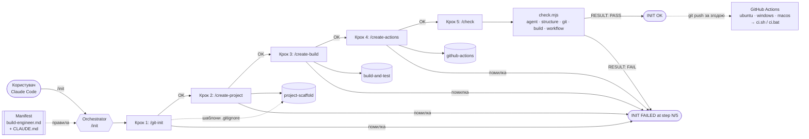

# Архітектура AI-агента `build-engineer`

Варіант 6: **TypeScript**, система складання — **npm scripts**, тестування — **Vitest**.
AI-інструмент — **Claude Code** (CLI), тому агент описаний у стандартному форматі Claude Code
(`CLAUDE.md`, `.claude/agents`, `.claude/skills`, `.claude/commands`).

## 1. Які проблеми вирішує агент

Навіть мінімальний кросплатформний TypeScript-проєкт із тестами і CI складається з багатьох
дрібних кроків, у яких легко помилитися. Агент формалізує ці кроки.

| Проблема | Як її вирішує агент |
|---|---|
| Неоднозначний запит «зроби проєкт» | точні шаблони кожного файлу у skills, фіксовані вхідні параметри в manifest |
| Розбіжність локальної збірки і CI | уся логіка — у `ci.sh` / `ci.bat`; `ci.yml` лише викликає їх |
| Невідтворювані залежності | точні версії (`--save-exact`) і `package-lock.json`; у скриптах — `npm ci` |
| TypeScript не запускається без компіляції / потрібен виконуваний файл | `tsc --noEmit` для перевірки типів, `esbuild` — bundle, `node --build-sea` — самостійний `hello[.exe]` |
| CRLF у `ci.sh` або LF у `ci.bat`, відсутній біт виконання | `.gitattributes` (`*.sh eol=lf`, `*.bat eol=crlf`), `git update-index --chmod=+x`, `/check` перевіряє кінці рядків |
| Артефакти / секрети в Git | `/git-init` доповнює `.gitignore`; `/check` перевіряє `git ls-files` і шукає секрети |
| «Успіх» без перевірки | оркестратор успішний лише після `RESULT: PASS` детермінованого `check.mjs` |
| Повторний запуск ламає файли | кожна команда ідемпотентна: `CREATE` / `SKIP` / `DIFF` + запит, без перезапису |
| Небезпечні дії AI | заборони в manifest: видалення, force-push, push без запиту, секрети, `|| true`, `continue-on-error` |

## 2. Компоненти

### Manifest

`.claude/agents/build-engineer.md` — роль, вхідні параметри, область відповідальності, правила
роботи з файлами, заборонені дії, критерії завершення. `CLAUDE.md` у корені завантажується в
кожну сесію Claude Code і зобов’язує діяти за цим manifest.

### Skills

| Skill | Вхід | Результат | Перевірка |
|---|---|---|---|
| `project-scaffold` | `language=typescript`, `project_name=hello` | `package.json` (база), `src/greet.ts`, `src/main.ts`, `src/index.ts`, розділ README, `docs/usage.md`; шаблони `.gitignore` / `.gitattributes` | `npm start` → `Hello, World!` |
| `build-and-test` | файли з `project-scaffold` | `tsconfig.json`, `vitest.config.ts`, `src/calc.ts`, `tests/hello.test.ts`, `scripts/build-exe.mjs`, npm scripts і devDependencies, `package-lock.json`, `ci.sh`, `ci.bat`, `run.sh`, `run.bat` | `ci.bat` / `ci.sh` → `CI: SUCCESS`, `build/bin/hello[.exe]`, `BasicAddition` пройшов |
| `github-actions` | `ci.sh`, `ci.bat` | `.github/workflows/ci.yml` | `check.mjs --only workflow` |

### Commands

| Command | Викликає | Що робить |
|---|---|---|
| `/git-init` | шаблони зі skill `project-scaffold` | перевіряє репозиторій і гілку, доповнює `.gitignore` / `.gitattributes`, показує `git status` |
| `/create-project` | skill `project-scaffold` | створює початковий проєкт |
| `/create-build` | skill `build-and-test` | створює конфігурацію складання, тести, скрипти; виконує збірку |
| `/create-actions` | skill `github-actions` | створює CI workflow |
| `/check` | `.claude/scripts/check.mjs` | лише перевіряє: agent, structure, git, build, workflow |
| `/init` | 5 commands вище | оркестратор повного сценарію |

## 3. Схема взаємодії

## 4. Дані, що передаються між етапами

| Крок | Command | Вхід від попереднього кроку | Вихід для наступного кроку |
|---|---|---|---|
| 0 | передумови `/init` | git, Node.js ≥ 26, feature-гілка | запис про запуск у `docs/ai-log.md` |
| 1 | `/git-init` | робоче дерево Git | `.gitignore`, `.gitattributes`, назва гілки |
| 2 | `/create-project` | `.gitignore`, `project_name` | `package.json` (база), `src/*.ts`, `docs/usage.md` |
| 3 | `/create-build` | `package.json`, `src/main.ts` | npm scripts, `package-lock.json`, тести, `ci.*`, `run.*`, `build/bin/hello[.exe]`, `build/test-results/junit.xml` |
| 4 | `/create-actions` | `ci.sh`, `ci.bat` | `.github/workflows/ci.yml` |
| 5 | `/check` | усе вище | `RESULT: PASS` / `RESULT: FAIL` |

## 5. Обробка помилок оркестратором

- Перед стартом перевіряються передумови: `git`, Node.js ≥ 26, поточна гілка не `master` /
  `main` / `develop` (інакше — пропозиція створити `feature/lab1-ts-hello`).
- Кроки виконуються строго по черзі; результат кожного перевіряється перевірками зі skill.
- На першій помилці оркестратор зупиняється з повідомленням
  `INIT FAILED at step N/5 (<command>): <message>`; наступні кроки не виконуються, нічого не
  видаляється і не відкочується.
- Виправлення вноситься в інструкції (skill або command), а не ручною правкою результату; після
  цього `/init` можна перезапустити — усі кроки ідемпотентні (`CREATE` / `SKIP` / `DIFF`).
- Успіх (`INIT OK`) повідомляється лише після `RESULT: PASS` від `/check`; помилки не
  приховуються (`|| true`, `continue-on-error` заборонені manifest і перевіряються `/check`).

## 6. Відповідність структурі з методички (Copilot → Claude Code)

| Методичка (GitHub Copilot) | Реалізація (Claude Code) |
|---|---|
| `.github/agents/build-engineer.agent.md` | `.claude/agents/build-engineer.md` (subagent) + `CLAUDE.md` |
| `.github/skills/*/SKILL.md` | `.claude/skills/{project-scaffold,build-and-test,github-actions}/SKILL.md` |
| `.github/prompts/*.prompt.md` | `.claude/commands/*.md` (slash-команди) |
| `init.prompt.md`, `check.prompt.md` | `.claude/commands/init.md`, `check.md` + `.claude/scripts/check.mjs` |
| `.github/workflows/ci.yml` | `.github/workflows/ci.yml` (без змін) |
| `CMakeLists.txt` | `package.json` (npm scripts) + `tsconfig.json` + `vitest.config.ts` + `ci.sh` / `ci.bat` (варіант 6) |
| `src/`, `tests/`, `docs/` | `src/`, `tests/`, `docs/` (без змін) |

Примітка: у Claude Code є вбудована команда `/init`. Проєктна команда `.claude/commands/init.md`
її перекриває (перевірено запуском `claude -p "/init"` з тестовою командою), тому назву
оркестратора з методички збережено.
